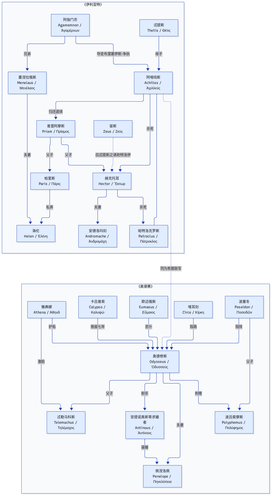

# 荷马史诗 · 现代小说版

把《伊利亚特》与《奥德赛》写成可一口气读完的现代汉语叙事：保留史诗骨架与关键名场面，文风口语、清楚，不戏说。

**建议阅读顺序：**先《伊利亚特》，再《奥德赛》（后者承接特洛伊陷落之后的归乡）。

## 已上线

| 书 | 说明 | 篇幅 |
| --- | --- | --- |
| [伊利亚特（现代小说版）](./伊利亚特_现代版.md) | 阿喀琉斯的愤怒、帕特洛克罗斯之死、赫克托耳的葬礼 | 约 34210 字 |
| [奥德赛（现代小说版）](./奥德赛_现代版.md) | 奥德修斯海上漂泊十年，归家复仇与团圆 | 约 33462 字 |

## 故事怎么接上

《伊利亚特》写到赫克托耳（Hector / Ἕκτωρ）葬礼为止；后记交代阿喀琉斯（Achilles / Ἀχιλλεύς）之死与木马破城。十年后，《奥德赛》从伊塔卡的求婚者与海上的奥德修斯（Odysseus / Ὀδυσσεύς）两侧起笔，收束于归家。

更细的 mermaid 源图见 [关系简图.md](./关系简图.md)；覆盖两书全部人物的大图见 [人物关系全图.md](./人物关系全图.md)。

## 伊利亚特 · 目录

- [序章 一只金苹果](./伊利亚特_现代版.md#iliad-prologue)
- [第一章 一个女人引发的愤怒](./伊利亚特_现代版.md#iliad-ch01)
- [第二章 宙斯送来的假梦](./伊利亚特_现代版.md#iliad-ch02)
- [第三章 城墙上的海伦](./伊利亚特_现代版.md#iliad-ch03)
- [第四章 一支破坏誓约的箭](./伊利亚特_现代版.md#iliad-ch04)
- [第五章 狄俄墨得斯的光辉](./伊利亚特_现代版.md#iliad-ch05)
- [第六章 城门边的告别](./伊利亚特_现代版.md#iliad-ch06)
- [第七章 宙斯的金天平](./伊利亚特_现代版.md#iliad-ch07)
- [第八章 被拒绝的礼物](./伊利亚特_现代版.md#iliad-ch08)
- [第九章 黑夜里的间谍](./伊利亚特_现代版.md#iliad-ch09)
- [第十章 战火烧到船边](./伊利亚特_现代版.md#iliad-ch10)
- [第十一章 赫拉的腰带](./伊利亚特_现代版.md#iliad-ch11)
- [第十二章 穿上阿喀琉斯铠甲的人](./伊利亚特_现代版.md#iliad-ch12)
- [第十三章 噩耗](./伊利亚特_现代版.md#iliad-ch13)
- [第十四章 愤怒转向](./伊利亚特_现代版.md#iliad-ch14)
- [第十五章 与河神搏斗](./伊利亚特_现代版.md#iliad-ch15)
- [第十六章 特洛伊城下的追逐](./伊利亚特_现代版.md#iliad-ch16)
- [第十七章 献给亡友的葬礼](./伊利亚特_现代版.md#iliad-ch17)
- [第十八章 老人在敌营](./伊利亚特_现代版.md#iliad-ch18)
- [第十九章 驯马的赫克托耳](./伊利亚特_现代版.md#iliad-ch19)
- [后记](./伊利亚特_现代版.md#iliad-epilogue)

## 奥德赛 · 目录

- [第一章 宫殿里的豺狼](./奥德赛_现代版.md#odyssey-ch01)
- [第二章 少年出海](./奥德赛_现代版.md#odyssey-ch02)
- [第三章 老将涅斯托尔](./奥德赛_现代版.md#odyssey-ch03)
- [第四章 斯巴达的海伦](./奥德赛_现代版.md#odyssey-ch04)
- [第五章 卡吕普索的岛](./奥德赛_现代版.md#odyssey-ch05)
- [第六章 河边的公主](./奥德赛_现代版.md#odyssey-ch06)
- [第七章 盲歌手的歌](./奥德赛_现代版.md#odyssey-ch07)
- [第八章 吃忘忧果的人](./奥德赛_现代版.md#odyssey-ch08)
- [第九章 我的名字叫“无人”](./奥德赛_现代版.md#odyssey-ch09)
- [第十章 风袋与吃人的巨人](./奥德赛_现代版.md#odyssey-ch10)
- [第十一章 喀耳刻的魔药](./奥德赛_现代版.md#odyssey-ch11)
- [第十二章 走进冥府](./奥德赛_现代版.md#odyssey-ch12)
- [第十三章 塞壬的歌声](./奥德赛_现代版.md#odyssey-ch13)
- [第十四章 太阳神的牛](./奥德赛_现代版.md#odyssey-ch14)
- [第十五章 牧猪奴的茅屋](./奥德赛_现代版.md#odyssey-ch15)
- [第十六章 父与子](./奥德赛_现代版.md#odyssey-ch16)
- [第十七章 老狗阿尔戈斯](./奥德赛_现代版.md#odyssey-ch17)
- [第十八章 伤疤](./奥德赛_现代版.md#odyssey-ch18)
- [第十九章 弓](./奥德赛_现代版.md#odyssey-ch19)
- [第二十章 复仇](./奥德赛_现代版.md#odyssey-ch20)
- [第二十一章 橄榄树做的床](./奥德赛_现代版.md#odyssey-ch21)
- [第二十二章 果园里的老人](./奥德赛_现代版.md#odyssey-ch22)

## 摘一句

> 歌唱吧，女神，歌唱珀琉斯（Peleus / Πηλεύς）之子阿喀琉斯的愤怒。那致命的愤怒给阿开奥斯人带来无数苦难……

## 怎么用

- 想建立整体感：按上表顺序，从序章／第一章读到后记
- 只想抓人物关系：先看本页简图，再跳进对应章节
- 史诗原文属公有领域；精读请回通行译本（如罗念生、王焕生等）

## 授权

荷马史诗情节属公有领域。本目录下的现代汉语重写按仓库 [CC BY 4.0](../LICENSE) 授权。
