# 荷马史诗 · 人物关系全图

两书人物较多，分成两张图。节点格式：中文名 English / Ἑλληνικά；颜色按阵营区分，虚线为间接关系或只在故事中被提到的关系。

覆盖率：《伊利亚特》人物表 69/69（100%），《奥德赛》人物表 63/63（100%）。

## 《伊利亚特》

蓝＝希腊联军，红＝特洛伊及盟军，黄＝神明，灰＝故事中提到的古人。PNG：[荷马史诗_人物关系全图_伊利亚特.png](./荷马史诗_人物关系全图_伊利亚特.png)

```mermaid
flowchart TB
  subgraph G["希腊联军（阿开奥斯人）"]
    n0["阿喀琉斯<br/>Achilles / Ἀχιλλεύς"]:::gr
    n1["帕特洛克罗斯<br/>Patroclus / Πάτροκλος"]:::gr
    n2["珀琉斯<br/>Peleus / Πηλεύς"]:::gr
    n3["阿伽门农<br/>Agamemnon / Ἀγαμέμνων"]:::gr
    n4["墨涅拉俄斯<br/>Menelaus / Μενέλαος"]:::gr
    n5["阿特柔斯<br/>Atreus / Ἀτρεύς"]:::gr
    n6["奥德修斯<br/>Odysseus / Ὀδυσσεύς"]:::gr
    n7["埃阿斯<br/>Ajax / Αἴας"]:::gr
    n8["小埃阿斯<br/>Ajax the Lesser / Αἴας ὁ Λοκρός"]:::gr
    n9["狄俄墨得斯<br/>Diomedes / Διομήδης"]:::gr
    n10["堤丢斯<br/>Tydeus / Τυδεύς"]:::gr
    n11["斯忒涅洛斯<br/>Sthenelus / Σθένελος"]:::gr
    n12["涅斯托尔<br/>Nestor / Νέστωρ"]:::gr
    n13["安提洛科斯<br/>Antilochus / Ἀντίλοχος"]:::gr
    n14["伊多墨纽斯<br/>Idomeneus / Ἰδομενεύς"]:::gr
    n15["墨里俄涅斯<br/>Meriones / Μηριόνης"]:::gr
    n16["马卡昂<br/>Machaon / Μαχάων"]:::gr
    n17["卡尔卡斯<br/>Calchas / Κάλχας"]:::gr
    n18["福尼克斯<br/>Phoenix / Φοῖνιξ"]:::gr
    n19["欧墨洛斯<br/>Eumelus / Εὔμηλος"]:::gr
    n20["普罗忒西拉俄斯<br/>Protesilaus / Πρωτεσίλαος"]:::gr
    n21["布里塞伊斯<br/>Briseis / Βρισηΐς"]:::gr
    n22["克律塞伊斯<br/>Chryseis / Χρυσηΐς"]:::gr
    n23["克律塞斯<br/>Chryses / Χρύσης"]:::gr
    n24["巴利俄斯<br/>Balius / Βαλίος"]:::gr
    n25["克珊托斯<br/>Xanthos / Ξάνθος"]:::gr
  end
  subgraph T["特洛伊及盟军"]
    n26["普里阿摩斯<br/>Priam / Πρίαμος"]:::tr
    n27["赫卡柏<br/>Hecuba / Ἑκάβη"]:::tr
    n28["赫克托耳<br/>Hector / Ἕκτωρ"]:::tr
    n29["安德洛玛刻<br/>Andromache / Ἀνδρομάχη"]:::tr
    n30["阿斯提阿那克斯<br/>Astyanax / Ἀστυάναξ"]:::tr
    n31["斯卡曼德里奥斯<br/>Scamandrius / Σκαμάνδριος"]:::tr
    n32["帕里斯<br/>Paris / Πάρις"]:::tr
    n33["海伦<br/>Helen / Ἑλένη"]:::tr
    n34["得伊福玻斯<br/>Deiphobus / Δηΐφοβος"]:::tr
    n35["赫勒诺斯<br/>Helenus / Ἕλενος"]:::tr
    n36["卡珊德拉<br/>Cassandra / Κασσάνδρη"]:::tr
    n37["埃涅阿斯<br/>Aeneas / Αἰνείας"]:::tr
    n38["安忒诺尔<br/>Antenor / Ἀντήνωρ"]:::tr
    n39["阿革诺尔<br/>Agenor / Ἀγήνωρ"]:::tr
    n40["波吕达马斯<br/>Polydamas / Πουλυδάμας"]:::tr
    n41["潘达罗斯<br/>Pandarus / Πάνδαρος"]:::tr
    n42["欧福耳玻斯<br/>Euphorbus / Εὔφορβος"]:::tr
    n43["多隆<br/>Dolon / Δόλων"]:::tr
    n44["瑞索斯<br/>Rhesus / Ῥῆσος"]:::tr
    n45["格劳科斯<br/>Glaucus / Γλαῦκος"]:::tr
    n46["达耳达诺斯<br/>Dardanus / Δάρδανος"]:::tr
  end
  subgraph D["神明"]
    n47["宙斯<br/>Zeus / Ζεύς"]:::god
    n48["赫拉<br/>Hera / Ἥρα"]:::god
    n49["雅典娜<br/>Athena / Ἀθηνᾶ"]:::god
    n50["波塞冬<br/>Poseidon / Ποσειδῶν"]:::god
    n51["阿波罗<br/>Apollo / Ἀπόλλων"]:::god
    n52["阿耳忒弥斯<br/>Artemis / Ἄρτεμις"]:::god
    n53["阿佛洛狄忒<br/>Aphrodite / Ἀφροδίτη"]:::god
    n54["阿瑞斯<br/>Ares / Ἄρης"]:::god
    n55["赫淮斯托斯<br/>Hephaestus / Ἥφαιστος"]:::god
    n56["赫尔墨斯<br/>Hermes / Ἑρμῆς"]:::god
    n57["伊里斯<br/>Iris / Ἶρις"]:::god
    n58["忒提斯<br/>Thetis / Θέτις"]:::god
    n59["厄里斯<br/>Eris / Ἔρις"]:::god
    n60["睡神<br/>Hypnos / Ὕπνος"]:::god
    n61["死神<br/>Thanatos / Θάνατος"]:::god
    n62["哈得斯<br/>Hades / Ἅιδης"]:::god
    n63["德墨忒尔<br/>Demeter / Δημήτηρ"]:::god
    n64["俄刻阿诺斯<br/>Oceanus / Ὠκεανός"]:::god
    n65["斯卡曼德罗斯<br/>Scamander / Σκάμανδρος"]:::god
  end
  subgraph O["故事中提到的古人"]
    n66["赫拉克勒斯<br/>Heracles / Ἡρακλῆς"]:::oth
    n67["墨勒阿革洛斯<br/>Meleager / Μελέαγρος"]:::oth
    n68["尼俄柏<br/>Niobe / Νιόβη"]:::oth
  end
  n2 -->|"夫妻"| n58
  n58 -->|"母子"| n0
  n2 -->|"父子"| n0
  n0 -->|"挚友"| n1
  n5 -->|"父子"| n3
  n5 -->|"父子"| n4
  n4 -->|"夫妻"| n33
  n32 -->|"私奔"| n33
  n3 -->|"夺走女俘"| n21
  n0 -->|"女俘"| n21
  n23 -->|"父女"| n22
  n3 -->|"扣留"| n22
  n23 -->|"祈求降瘟"| n51
  n17 -->|"揭示神怒"| n3
  n10 -->|"父子"| n9
  n11 -->|"御者"| n9
  n12 -->|"父子"| n13
  n14 -->|"同伴"| n15
  n18 -->|"教导"| n0
  n6 -->|"同往劝和"| n18
  n6 -->|"夜袭杀死"| n43
  n9 -->|"夜袭杀死"| n44
  n9 -->|"刺伤"| n53
  n9 -->|"刺伤"| n54
  n9 -->|"交换铠甲"| n45
  n41 -->|"暗箭射伤"| n4
  n41 -->|"射伤"| n16
  n26 -->|"夫妻"| n27
  n26 -->|"父子"| n28
  n26 -->|"父子"| n32
  n26 -->|"父子"| n34
  n26 -->|"父子"| n35
  n26 -->|"父女"| n36
  n28 -->|"夫妻"| n29
  n28 -->|"父子"| n30
  n31 -->|"同一人"| n30
  n35 -->|"劝谏"| n28
  n40 -->|"献策"| n28
  n38 -->|"主张归还海伦"| n32
  n46 -->|"王族始祖"| n26
  n53 -->|"母子"| n37
  n42 -->|"先伤"| n1
  n28 -->|"杀死"| n1
  n0 -->|"杀死"| n28
  n0 -->|"归还遗体"| n26
  n39 -->|"迎战"| n0
  n32 -->|"射杀（后记）"| n0
  n28 -.->|"杀死"| n20
  n7 -->|"决斗"| n28
  n8 -->|"同名战友"| n7
  n19 -->|"赛车"| n13
  n25 -->|"神马"| n0
  n24 -->|"神马"| n0
  n47 -->|"夫妻"| n48
  n47 -->|"父女"| n49
  n47 -->|"父子"| n51
  n47 -->|"兄弟"| n50
  n47 -->|"兄弟"| n62
  n47 -.->|"姐弟"| n63
  n51 -->|"孪生"| n52
  n48 -->|"母子"| n55
  n55 -->|"打造盾牌"| n0
  n55 -->|"火攻"| n65
  n65 -->|"河中搏斗"| n0
  n64 -.->|"众神之祖"| n65
  n60 -->|"孪生"| n61
  n48 -->|"请其催眠宙斯"| n60
  n57 -->|"传令"| n26
  n56 -->|"护送入营"| n26
  n59 -->|"金苹果"| n32
  n58 -->|"求情"| n47
  n49 -->|"庇护"| n0
  n49 -->|"庇护"| n9
  n48 -->|"庇护"| n3
  n51 -->|"庇护"| n28
  n50 -->|"援助"| n7
  n54 -->|"援助"| n28
  n47 -->|"父子"| n66
  n18 -.->|"讲述"| n67
  n0 -.->|"讲述"| n68
  classDef gr fill:#dbeafe,stroke:#1e40af,color:#111
  classDef tr fill:#fee2e2,stroke:#b91c1c,color:#111
  classDef god fill:#fef3c7,stroke:#b45309,color:#111
  classDef oth fill:#e5e7eb,stroke:#374151,color:#111
  linkStyle default stroke:#555,stroke-width:1.2px
```

## 《奥德赛》

绿＝伊塔卡，红＝求婚者，蓝＝希腊旧友与特洛伊旧事，紫＝冒险途中，黄＝神明。PNG：[荷马史诗_人物关系全图_奥德赛.png](./荷马史诗_人物关系全图_奥德赛.png)

```mermaid
flowchart TB
  subgraph I["伊塔卡"]
    n0["奥德修斯<br/>Odysseus / Ὀδυσσεύς"]:::ith
    n1["佩涅洛佩<br/>Penelope / Πηνελόπεια"]:::ith
    n2["忒勒马科斯<br/>Telemachus / Τηλέμαχος"]:::ith
    n3["拉埃尔特斯<br/>Laertes / Λαέρτης"]:::ith
    n4["奥托吕科斯<br/>Autolycus / Αὐτόλυκος"]:::ith
    n5["欧律克勒娅<br/>Eurycleia / Εὐρύκλεια"]:::ith
    n6["欧迈俄斯<br/>Eumaeus / Εὔμαιος"]:::ith
    n7["菲罗提奥斯<br/>Philoetius / Φιλοίτιος"]:::ith
    n8["阿尔戈斯<br/>Argos / Ἄργος"]:::ith
    n9["门托尔<br/>Mentor / Μέντωρ"]:::ith
    n10["墨冬<br/>Medon / Μέδων"]:::ith
    n11["伊罗斯<br/>Irus / Ἶρος"]:::ith
    n12["忒奥克吕墨诺斯<br/>Theoclymenus / Θεοκλύμενος"]:::ith
  end
  subgraph S["求婚者"]
    n13["安提诺奥斯<br/>Antinous / Ἀντίνοος"]:::tr
    n14["欧佩特斯<br/>Eupeithes / Εὐπείθης"]:::tr
    n15["欧律马科斯<br/>Eurymachus / Εὐρύμαχος"]:::tr
  end
  subgraph G["希腊旧友与特洛伊旧事"]
    n16["涅斯托尔<br/>Nestor / Νέστωρ"]:::gr
    n17["佩西斯特拉托斯<br/>Peisistratus / Πεισίστρατος"]:::gr
    n18["墨涅拉俄斯<br/>Menelaus / Μενέλαος"]:::gr
    n19["海伦<br/>Helen / Ἑλένη"]:::gr
    n20["阿伽门农<br/>Agamemnon / Ἀγαμέμνων"]:::gr
    n21["克吕泰涅斯特拉<br/>Clytemnestra / Κλυταιμνήστρη"]:::gr
    n22["俄瑞斯忒斯<br/>Orestes / Ὀρέστης"]:::gr
    n23["阿喀琉斯<br/>Achilles / Ἀχιλλεύς"]:::gr
    n24["涅俄普托勒摩斯<br/>Neoptolemus / Νεοπτόλεμος"]:::gr
    n25["帕特洛克罗斯<br/>Patroclus / Πάτροκλος"]:::gr
    n26["安提洛科斯<br/>Antilochus / Ἀντίλοχος"]:::gr
    n27["埃阿斯<br/>Ajax / Αἴας"]:::gr
    n28["小埃阿斯<br/>Ajax the Lesser / Αἴας ὁ Λοκρός"]:::gr
    n29["狄俄墨得斯<br/>Diomedes / Διομήδης"]:::gr
    n30["菲罗克忒忒斯<br/>Philoctetes / Φιλοκτήτης"]:::gr
    n31["厄珀俄斯<br/>Epeius / Ἐπειός"]:::gr
    n32["得伊福玻斯<br/>Deiphobus / Δηΐφοβος"]:::gr
  end
  subgraph A["冒险途中"]
    n33["卡吕普索<br/>Calypso / Καλυψώ"]:::adv
    n34["阿尔基诺奥斯<br/>Alcinous / Ἀλκίνοος"]:::adv
    n35["阿瑞忒<br/>Arete / Ἀρήτη"]:::adv
    n36["瑙西卡<br/>Nausicaa / Ναυσικάα"]:::adv
    n37["欧律阿洛斯<br/>Euryalus / Εὐρύαλος"]:::adv
    n38["得摩多科斯<br/>Demodocus / Δημόδοκος"]:::adv
    n39["波吕斐摩斯<br/>Polyphemus / Πολύφημος"]:::adv
    n40["埃俄罗斯<br/>Aeolus / Αἴολος"]:::adv
    n41["喀耳刻<br/>Circe / Κίρκη"]:::adv
    n42["欧律罗科斯<br/>Eurylochus / Εὐρύλοχος"]:::adv
    n43["埃尔佩诺尔<br/>Elpenor / Ἐλπήνωρ"]:::adv
    n44["忒瑞西阿斯<br/>Tiresias / Τειρεσίας"]:::adv
    n45["塞壬<br/>Sirens / Σειρῆνες"]:::adv
    n46["斯库拉<br/>Scylla / Σκύλλη"]:::adv
    n47["卡律布狄斯<br/>Charybdis / Χάρυβδις"]:::adv
  end
  subgraph D["神明"]
    n48["宙斯<br/>Zeus / Ζεύς"]:::god
    n49["雅典娜<br/>Athena / Ἀθηνᾶ"]:::god
    n50["波塞冬<br/>Poseidon / Ποσειδῶν"]:::god
    n51["赫尔墨斯<br/>Hermes / Ἑρμῆς"]:::god
    n52["赫利俄斯<br/>Helios / Ἥλιος"]:::god
    n53["门忒斯<br/>Mentes / Μέντης"]:::god
    n54["伊诺<br/>Ino / Ἰνώ"]:::god
    n55["阿波罗<br/>Apollo / Ἀπόλλων"]:::god
    n56["阿耳忒弥斯<br/>Artemis / Ἄρτεμις"]:::god
    n57["阿佛洛狄忒<br/>Aphrodite / Ἀφροδίτη"]:::god
    n58["阿瑞斯<br/>Ares / Ἄρης"]:::god
    n59["赫淮斯托斯<br/>Hephaestus / Ἥφαιστος"]:::god
    n60["哈得斯<br/>Hades / Ἅιδης"]:::god
    n61["俄刻阿诺斯<br/>Oceanus / Ὠκεανός"]:::god
    n62["缪斯<br/>Muse / Μοῦσα"]:::god
  end
  n0 -->|"夫妻"| n1
  n0 -->|"父子"| n2
  n3 -->|"父子"| n0
  n4 -->|"外祖父"| n0
  n5 -->|"奶妈·认出伤疤"| n0
  n6 -->|"忠仆"| n0
  n7 -->|"忠仆"| n0
  n8 -->|"老狗认主"| n0
  n9 -->|"老友·辅佐"| n2
  n12 -->|"预言"| n2
  n0 -->|"饶恕"| n10
  n0 -->|"击倒"| n11
  n13 -->|"求婚"| n1
  n15 -->|"求婚"| n1
  n14 -->|"父子"| n13
  n0 -->|"射杀"| n13
  n0 -->|"杀死"| n15
  n3 -->|"杀死"| n14
  n2 -->|"拜访"| n16
  n16 -->|"父子"| n17
  n17 -->|"同行"| n2
  n16 -->|"父子"| n26
  n2 -->|"拜访"| n18
  n18 -->|"夫妻"| n19
  n20 -->|"兄弟"| n18
  n20 -->|"夫妻"| n21
  n21 -->|"谋害"| n20
  n20 -->|"父子"| n22
  n23 -->|"父子"| n24
  n23 -->|"挚友"| n25
  n0 -->|"争夺铠甲结怨"| n27
  n28 -->|"触怒海神淹死"| n50
  n29 -.->|"平安归国"| n16
  n30 -.->|"平安归国"| n16
  n31 -->|"建造木马"| n0
  n19 -->|"木马旁试探"| n32
  n33 -->|"挽留七年"| n0
  n34 -->|"夫妻"| n35
  n34 -->|"父女"| n36
  n36 -->|"救助"| n0
  n37 -->|"挑衅"| n0
  n38 -->|"吟唱特洛伊"| n0
  n34 -->|"送其归乡"| n0
  n50 -->|"父子"| n39
  n0 -->|"刺瞎"| n39
  n40 -->|"赠风袋"| n0
  n41 -->|"把同伴变猪"| n42
  n41 -->|"情人·指路"| n0
  n42 -->|"副手"| n0
  n43 -->|"亡魂求葬"| n0
  n44 -->|"冥府预言"| n0
  n45 -->|"歌声诱惑"| n0
  n46 -->|"吞食同伴"| n0
  n47 -->|"漩涡"| n0
  n52 -->|"圣牛被吃·求罚"| n48
  n48 -->|"父女"| n49
  n48 -->|"兄弟"| n50
  n49 -->|"庇护"| n0
  n49 -->|"化身"| n53
  n53 -->|"激励"| n2
  n50 -->|"敌对"| n0
  n51 -->|"传令放人"| n33
  n51 -->|"赠草药"| n0
  n54 -->|"赠头巾救命"| n0
  n57 -->|"偷情（歌中）"| n58
  n59 -->|"夫妻·捉奸"| n57
  n55 -->|"孪生"| n56
  n55 -.->|"节日助射"| n0
  n60 -.->|"冥府之主"| n44
  n61 -.->|"冥府入口"| n60
  n62 -->|"赐歌"| n38
  classDef ith fill:#dcfce7,stroke:#15803d,color:#111
  classDef tr fill:#fee2e2,stroke:#b91c1c,color:#111
  classDef gr fill:#dbeafe,stroke:#1e40af,color:#111
  classDef adv fill:#ede9fe,stroke:#6d28d9,color:#111
  classDef god fill:#fef3c7,stroke:#b45309,color:#111
  linkStyle default stroke:#555,stroke-width:1.2px
```

